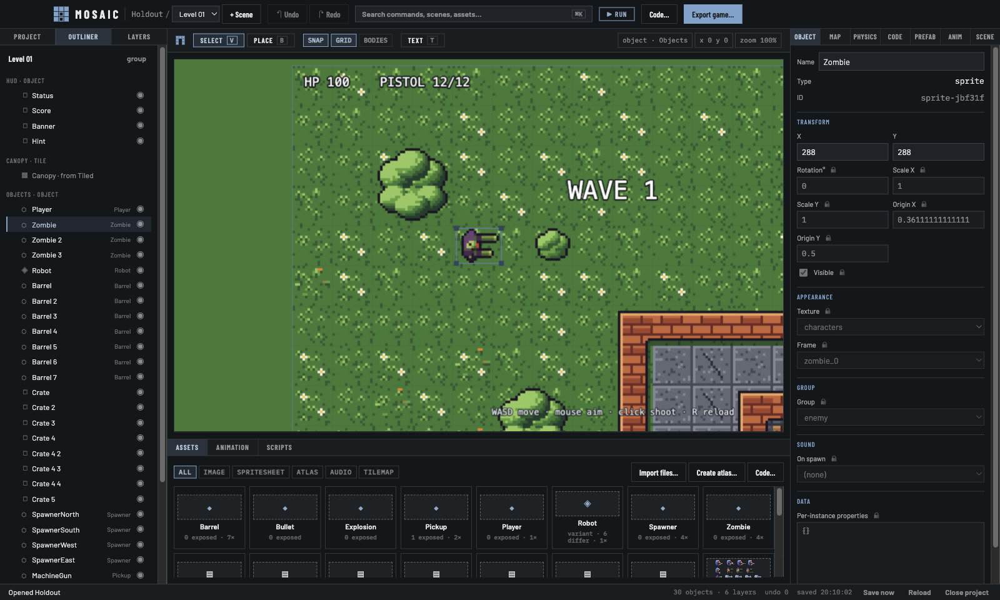
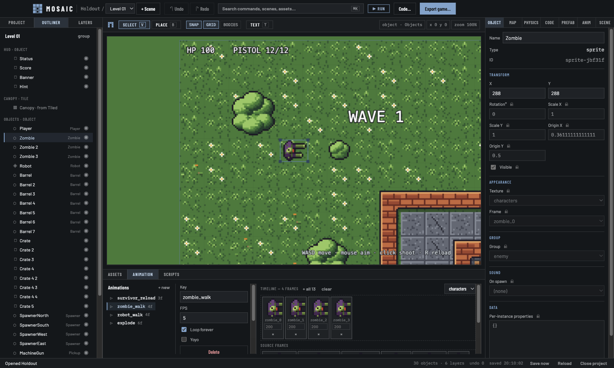
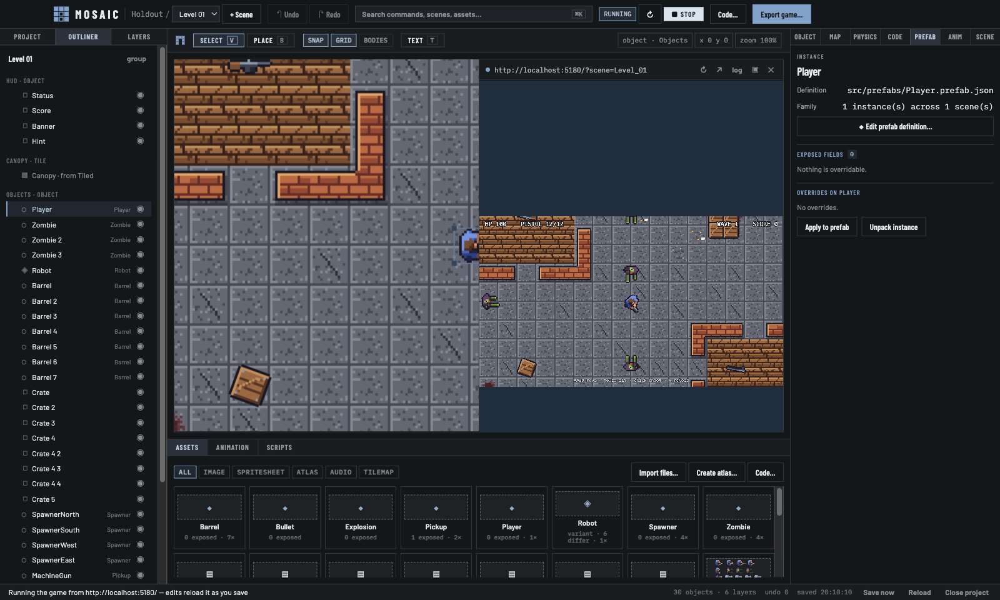

# Mosaic

A desktop scene editor for [Phaser](https://phaser.io) games.

Mosaic lays out your scenes visually, and you write the game in your own code
editor. Open a Phaser project folder, place sprites, maps and text on a canvas
that is a real Phaser scene, and Mosaic writes a layout file beside each scene
class. Your scene's `create()` calls it and gets every object back by name.
The rest of the game stays plain Phaser code that you own.

## What it does

- **Scenes:** place and arrange sprites, text and Tiled maps on a
  live Phaser canvas, with layers, snapping and undo.
- **Assets:** import images, spritesheets, atlases and audio, and slice sheets
  into atlases.
- **Prefabs:** turn an object into a reusable prefab backed by its own class,
  with variants and per-instance values.
- **Animation:** build animations from atlas frames on a timeline.
- **Physics:** give objects Arcade bodies and groups, sized from their art.
- **Run:** play the game from its own dev server beside the canvas. It reloads
  as you save.
- **Existing games:** open a Phaser 3 or 4 game Mosaic didn't make and import
  its scenes.
- **Export:** build a finished game into a folder that runs on its own.

